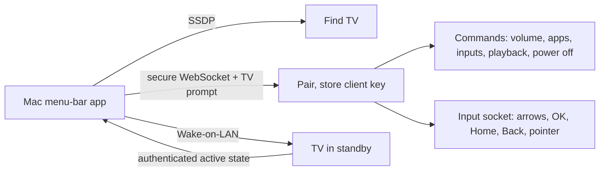

# LG TV Remote for Mac

A menu-bar remote for LG webOS TVs that runs entirely on the local network. It finds the TV, pairs
through the TV's own on-screen prompt, and then drives it from the Mac: arrows, OK, Home and Back,
a trackpad that moves the TV's pointer, playback, volume and mute, app launching by name, inputs,
channels, and power on from standby through Wake-on-LAN. No LG account or cloud service is
involved. Every feature in the release was confirmed on a real TV (LG UQ8040PSB), not just
acknowledged by it.

Article: [I Keep Losing My TV Remote, So I Turned My Mac Into One](https://palindromerice.github.io/writing/lgtv-remote/)

## Why

The physical remote gets lost; the laptop does not. LG's webOS TVs already accept commands from
devices on the same network through a local WebSocket service used by second-screen apps, so a
Mac can be a full remote without decompiling LG's phone app or touching the cloud.

## How it works

- **Discovery and pairing.** The Mac finds the TV with an SSDP query, opens a secure WebSocket to
  it and asks to be registered. The TV shows a prompt; once accepted it issues a client key, which
  is stored in the user's private application data, never in the app or the repository.
- **Commands.** Volume, mute, app launch, inputs, channels, playback and power off are JSON
  requests on the main connection. Navigation keys and the pointer go through a second input
  socket that the TV opens on request.
- **Trackpad.** One persistent pointer connection per session. Movement is coalesced to at most
  25 updates per second and sent one at a time, so a fast drag cannot flood the TV.
- **Power on.** While the TV is on, the app reads its network hardware addresses over the paired
  connection and saves them privately. Power On sends Wake-on-LAN packets and only reports success
  once the TV answers again on its authenticated connection and reports an active state.
- **Packaging.** A native AppKit menu-bar app with the Python protocol backend frozen inside the
  bundle, so nothing else needs to be installed.



## What was verified

A command counts as working only when its effect was confirmed: by the TV's own reported state
where it reports one, otherwise by watching the screen.

| Feature | Confirmed by |
|---|---|
| Find and pair the TV | TV prompt accepted; reconnects after restart |
| Volume and mute | TV-reported volume and mute changes |
| Arrows, OK, Back, Home | Watched on screen; Home also by foreground-app readback |
| Trackpad move, click and scroll | Watched on screen |
| Pause, play, fast-forward, rewind | Watched on a playing video |
| Launch installed apps by name | Watched on screen; foreground-app readback |
| Switch TV inputs, channel up and down | Watched on screen |
| Power on from standby | TV became unreachable after power off, then reported active again |

Offline tests cover the protocol messages, Wake-on-LAN packets, pointer streaming and error
handling against simulated TVs. A separate check runs the packaged app from a copied location with
access to the source tree blocked.

## Limitations

- Tested on one TV model and one Mac; other models and webOS versions may behave differently.
- The released app is Apple Silicon only, requires macOS 26 or newer, and is ad-hoc signed rather
  than notarized, so macOS warns on first open.
- Power on requires the TV's "Turn on via Wi-Fi" setting and works only on the same local network.
- Text entry and in-app search are not supported: streaming apps draw their own keyboards that the
  TV's text-input service cannot reach.

## License

Code is released under the [Apache License 2.0](LICENSE). See [NOTICE](NOTICE). LG and webOS are
trademarks of LG Electronics; this project is not affiliated with or endorsed by LG.

## Citation

```bibtex
@misc{chawla2026lgtvremote,
  author       = {Naman Chawla},
  title        = {I Keep Losing My TV Remote, So I Turned My Mac Into One},
  year         = {2026},
  howpublished = {\url{https://palindromerice.github.io/writing/lgtv-remote/}}
}
```

Machine-readable citation metadata is in [CITATION.cff](CITATION.cff).
